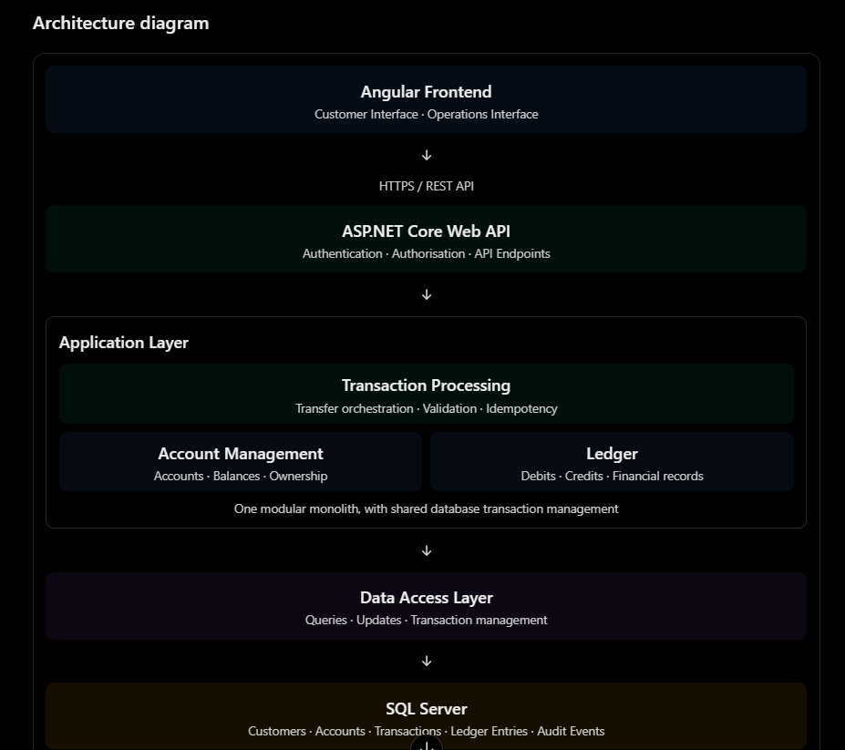

# System Architecture

## 1. Overview

Transactly will use a modular monolith architecture built with ASP.NET Core and SQL Server.

The architecture is designed to support secure and reliable internal account-to-account transfers while keeping the initial implementation straightforward and maintainable.

The system will have an Angular frontend communicating with an ASP.NET Core Web API. The backend will coordinate business operations across three core modules: Account Management, Transaction Processing and Ledger.

## 2. Architecture Style

### Modular Monolith

Transactly will be implemented as a modular monolith rather than a microservices-based system.

This approach is appropriate for the initial version because:
- The system has a focused business scope.
- Core modules have closely related responsibilities.
- Financial operations require coordinated database transactions.
- A single deployable application reduces infrastructure and operational complexity.
- Clear module boundaries allow the system to evolve as requirements grow.

Although the modules will exist within one application, each will maintain clearly defined responsibilities.

## 3. Technology Stack

| Component | Technology | Responsibility |
|---|---|---|
| Frontend | Angular | Customer and operations interfaces |
| Backend | ASP.NET Core Web API | Business logic, validation and transaction orchestration |
| Database | Microsoft SQL Server | Persistent application and financial data |
| Authentication | ASP.NET Core Identity | User management and password hashing |
| Access Control | JWT and RBAC | Authentication and permission enforcement |
| API Communication | REST | Communication between frontend and backend |

## 4. High-Level Architecture

The system will follow a layered architecture.

### 4.1 Presentation Layer
- Built with Angular.
- Provides customer and operations interfaces.
- Captures transfer instructions.
- Displays account information, transaction history and notifications.
- Performs basic frontend validation for usability.

### 4.2 API Layer
- Built with ASP.NET Core Web API.
- Exposes endpoints for frontend communication.
- Handles incoming HTTP requests.
- Applies authentication and authorisation.
- Returns appropriate HTTP responses and business-level error messages.

### 4.3 Application and Business Logic Layer
- Coordinates application workflows.
- Enforces business rules.
- Validates transfer instructions.
- Coordinates Account Management, Transaction Processing and Ledger operations.
- Manages transaction state transitions.

### 4.4 Data Access Layer
- Handles communication between application modules and SQL Server.
- Executes database queries and updates.
- Supports database transactions and concurrency controls.
- Ensures financial changes are committed or rolled back together.

### 4.5 Database Layer
- Stores customer, user and account information.
- Stores transfer records and transaction events.
- Maintains ledger entries and fund reservations.
- Enforces relevant database constraints and relationships.

## 5. Core Application Modules

### 5.1 Account Management
Responsible for:
- Managing customer and account information.
- Retrieving account details and balances.
- Validating account existence and status.
- Checking account ownership and access permissions.
- Supporting available balance calculations.

### 5.2 Transaction Processing
Responsible for:
- Receiving transfer requests.
- Coordinating transfer validation.
- Enforcing transfer limits and business rules.
- Managing idempotency.
- Coordinating debit and credit operations.
- Managing transaction states.
- Returning transaction outcomes.

Transaction Processing acts as the central coordinator of the transfer workflow.

### 5.3 Ledger
Responsible for:
- Recording financial debit and credit entries.
- Maintaining an accurate record of financial movements.
- Ensuring each successful transfer has balanced ledger entries.
- Supporting financial traceability and reconciliation.

### 5.4 Operations
Operations Officers will use dedicated interfaces and permissions to monitor transactions and investigate failures.

Operational functionality will be supported by the relevant application modules rather than implemented as a separate microservice.

## 6. Database Architecture

Transactly will use one shared SQL Server database for the initial implementation.

The database will contain data owned by the different modules.

| Module | Main Entities |
|---|---|
| Account Management | Customer, User, Account |
| Transaction Processing | Transaction, Transaction Event, Fund Reservation |
| Ledger | Ledger Entry |
| Access Control | Role, Permission |
| Operations | Investigation Note |

The modules will maintain clear data ownership and responsibilities despite sharing the same database.

### Database Transaction Management

Financial updates must happen within the same SQL Server database transaction.

For an internal transfer:
1. Validate the transfer request and available funds.
2. Begin a database transaction.
3. Record the sender's debit.
4. Record the recipient's credit.
5. Update the relevant account balances.
6. Commit the database transaction.

If a financial operation fails before commit, all related changes must be rolled back.

Database-level concurrency controls must prevent simultaneous transfers from spending the same available funds.

## 7. API Design

The frontend will communicate with the backend through RESTful endpoints.

The primary transfer endpoint will be:

`POST /api/transfers`

It will accept a transfer instruction containing:
- Sender account ID.
- Recipient account ID.
- Amount.
- Currency.
- Description.

An idempotency key will be supplied with the request to prevent duplicate processing.

The backend will coordinate the complete transfer workflow. The frontend will not independently initiate debit, credit or ledger operations.

## 8. Security Architecture

### 8.1 Authentication
- Use ASP.NET Core Identity for user management.
- Store passwords using secure password hashing.
- Issue and validate JWT access tokens for authenticated API requests.
- Require HTTPS for API communication.

### 8.2 Authorisation
- Implement Role-Based Access Control.
- Define permissions based on user responsibilities.
- Apply resource-level authorisation to customer accounts.
- Enforce permissions on the backend.
- Follow the principle of least privilege.

### 8.3 Data Protection
- Encrypt sensitive information at rest where appropriate.
- Use HTTPS/TLS to protect information in transit.
- Mask sensitive account details in responses and logs.
- Protect encryption keys and authentication secrets.
- Restrict database access.

### 8.4 Error Handling
- Return safe, business-level error messages to customers.
- Never expose stack traces, database exceptions or internal implementation details through API responses.
- Record technical failures in application logs for authorised technical personnel.

## 9. Logging, Auditing and Monitoring

Application logging and transaction auditing will be treated as separate concerns.

### Application Logs
Used to monitor application behaviour and diagnose technical issues, including:
- API failures.
- Database connection problems.
- Unexpected exceptions.
- Authentication failures.

### Transaction Audit Trail
Used to maintain a traceable record of financial transaction events, including:
- Transaction initiation.
- Validation outcomes.
- State transitions.
- Processing results.
- Success and failure events.
- Fund reservation and release events.

Audit records must be protected against unauthorised modification or deletion.

## 10. Future AI Integration

AI integration is not part of the initial implementation.

The architecture should, however, allow a future AI-powered assistant to interact with Transactly through controlled and secure APIs.

Potential future capabilities include:
- Explaining transaction statuses.
- Summarising transaction activity.
- Helping operations officers investigate failed transfers.
- Identifying unusual transaction patterns.
- Supporting natural-language queries over authorised business data.

Any future AI integration must respect existing authentication, authorisation, data protection and audit requirements.

AI-generated recommendations must not independently execute sensitive financial operations without appropriate controls and human approval.

## 11. Future Architectural Enhancements

Potential future enhancements include:
- External payment integrations.
- Cross-currency transfer processing.
- Transaction reversal workflows.
- Advanced reconciliation.
- Event-driven processing where justified.
- Distributed services if scale or operational requirements eventually demand them.
- AI-powered operations assistance.

## 12. Architectural Principles

The architecture will be guided by the following principles:

1. **Modularity:** Maintain clear responsibilities and boundaries between application modules.
2. **Security by Design:** Enforce authentication, authorisation and data protection throughout the system.
3. **Financial Integrity:** Prioritise accurate and consistent financial records.
4. **Atomicity:** Ensure related financial updates succeed or fail together.
5. **Idempotency:** Prevent duplicate execution of transfer requests.
6. **Traceability:** Maintain reliable transaction records and audit trails.
7. **Maintainability:** Keep the initial implementation straightforward and extensible.
8. **Separation of Concerns:** Keep presentation, business logic and data access responsibilities distinct.